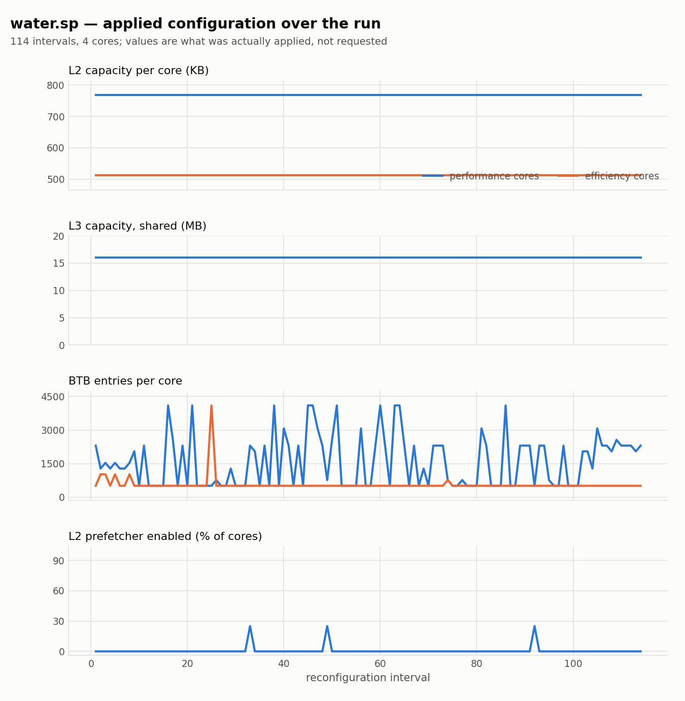
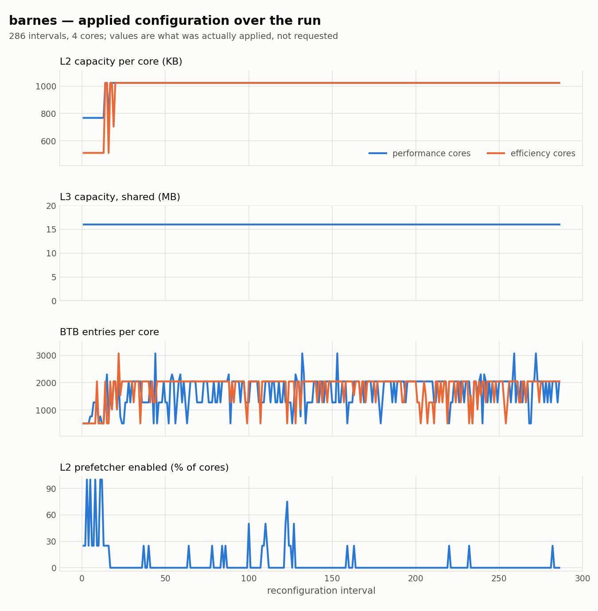
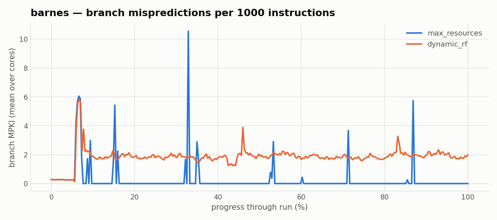
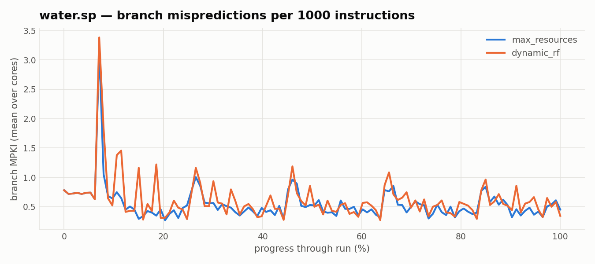

# When Does Runtime Reconfiguration Help? A Knob-Level Diagnosis

**Question.** The policy wins on most SPLASH-2 programs and loses badly on *barnes*. Is
the loss caused by shrinking the caches? If not, what causes it — and can we predict in
advance which workloads it will help?

**Answer in one line.** The loss has nothing to do with cache size: *barnes*'s caches are
never shrunk, and its hit rates improve more than any other benchmark's. The loss is
**branch mispredictions caused by a near-uniform BTB shrink**, applied to the one
workload that was never memory-bound. Baseline IPC predicts the outcome across all 42
cells with log-log *r* = −0.785.

Data: `results/n4_hetero_v2` (clamp policy, 84 runs, 1 M-instruction intervals). All
figures measured, none modelled. Reproduction commands at the end.

---

## 1. Knob trajectories

Applied values per reconfiguration interval, read directly from
`sniper_reconfig_decisions.csv`. Four panels rather than one chart because the knobs are
in four different units — putting two on a shared pair of axes would make the crossing
point an artefact of the scales.

### Best case — water.sp (21.2× IPS)



L2 drops to 640 KB in the first interval and **stays there for the whole run** — a 37.5%
reduction that actually sticks. L3 holds at 16 MB. The BTB is cut from 4096 to roughly
800–1,400 entries, and the prefetcher is off essentially throughout.

### Worst case — barnes (0.52× IPS)



**L2 returns to the full 1024 KB by interval ~20 and never moves again. L3 never leaves
16 MB.** Under `shrink_policy = clamp` the shrink requests are refused — barnes realises
2% of requested L2 reduction and 0% of L3. Any explanation of the barnes regression that
appeals to lost cache capacity is ruled out by construction: there was no lost capacity.

Only two knobs actually move: the BTB, cut to ~1,800 entries and oscillating hard, and
the prefetcher, disabled in 92–100% of core-intervals after an unstable opening.

---

## 2. What actually breaks

Whole-run statistics, both arms:

| | IPC | mispred rate | MPKI | L1-D hit | L2 hit | L3 hit |
|---|---|---|---|---|---|---|
| water.sp `max_resources` | 0.039 | 0.61% | 0.58 | 98.2% | 47.7% | 1.2% |
| water.sp `dynamic_rf` | **0.823** | 0.62% | 0.60 | 98.6% | **88.4%** | **68.0%** |
| barnes `max_resources` | 0.934 | **0.03%** | 0.09 | 98.9% | 3.0% | 8.8% |
| barnes `dynamic_rf` | **0.487** | **2.73%** | **1.89** | 97.5% | **96.4%** | 19.4% |

**barnes's caches got dramatically better and it still lost.** L2 hit rate rises from
3.0% to 96.4% — the largest cache improvement anywhere in the study — because disabling
the prefetcher stops it polluting L2. L3 hit roughly doubles. What collapses is branch
prediction: the misprediction rate rises 91×, from 0.03% to 2.73%.



The shape is the point. `max_resources` sits at essentially zero MPKI for the whole run,
with isolated spikes at phase boundaries. `dynamic_rf` sits at a **sustained ~1.9 MPKI
from 10% of the run onward** — not spikes, a persistent elevated floor, which is what a
capacity-starved BTB looks like.

*barnes* is a Barnes–Hut octree traversal: irregular, data-dependent, pointer-chasing
control flow that depends on BTB capacity. Cutting 4096 entries to ~1,800 removes the
structure it relies on.



*water.sp* is the mirror image: the same BTB shrink costs nothing measurable
(0.61% → 0.62%), while removing prefetcher pollution lifts L2 hit from 47.7% to 88.4%.

---

## 3. The BTB knob is not adaptive

Per benchmark at 4c 2P+2E — mean applied BTB, and the resulting change in branch and
cache behaviour:

| benchmark | BTB (mean) | ΔMPKI | ΔL2 hit (pp) | IPS × |
|---|---|---|---|---|
| barnes | 1730 | **+1.80** | +93.4 | **0.52** |
| radix | 1485 | +0.00 | +17.1 | 2.29 |
| volrend | 1696 | +0.00 | −0.2 | 3.30 |
| lu.ncont | 1278 | +0.00 | +3.2 | 3.33 |
| fft | 1308 | +0.00 | −16.6 | 3.61 |
| fmm | 1506 | +0.14 | +68.5 | 4.36 |
| cholesky | 1563 | +0.06 | +41.5 | 4.92 |
| raytrace | 1085 | +0.11 | +32.7 | 6.39 |
| ocean.ncont | 1112 | −0.00 | +15.6 | 7.22 |
| radiosity | 996 | **+4.02** | +58.5 | 7.28 |
| lu.cont | 1205 | +0.00 | +41.5 | 7.35 |
| ocean.cont | 1305 | −0.00 | +21.9 | 7.64 |
| water.nsq | 687 | −0.00 | +62.3 | 11.92 |
| water.sp | 1081 | +0.01 | +40.7 | 21.21 |

**The BTB choice is nearly constant** — 687 to 1,730 across fourteen structurally very
different workloads. The model is not adapting this knob; it applies roughly the same
shrink everywhere. For 11 of 14 that is free (ΔMPKI ≈ 0). For barnes it is fatal.

**ΔMPKI alone does not decide the outcome.** *radiosity* takes a larger branch hit than
barnes (+4.02 vs +1.80) and still gains 7.3×, because its cache improvement compensates.
What distinguishes barnes is that it had nothing to gain.

**L2 hit improves in 12 of 14**, confirming prefetcher-pollution relief as the dominant
mechanism. The exceptions, *fft* (−16.6 pp) and *volrend* (−0.2 pp), still gain on
throughput.

---

## 4. The predictor: baseline IPC

Sorting all 42 cells by the baseline arm's IPC gives a clean monotone relationship.

**log-log Pearson r = −0.785 (n = 42).**

| baseline IPC | IPS gain | interpretation |
|---|---|---|
| 0.04 – 0.19 | 3.6 – 21× | heavily memory-stalled; large headroom |
| 0.26 – 0.40 | 2.2 – 4.9× | partially stalled |
| 0.53 – 0.85 | 1.3 – 1.7× | little headroom left |
| 0.93 – 1.27 | **0.52×, 0.16×** | not memory-bound; net loss |

Full ordering:

| benchmark | topology | baseline IPC | IPS × |
|---|---|---|---|
| water.sp | 4c 2P+2E | 0.039 | 21.21 |
| volrend | 4c 2P+2E | 0.043 | 3.30 |
| water.nsq | 8c 4P+4E | 0.045 | 16.07 |
| water.sp | 8c 4P+4E | 0.046 | 17.77 |
| water.sp | 8c 2P+6E | 0.050 | 19.93 |
| water.nsq | 8c 2P+6E | 0.055 | 16.14 |
| water.nsq | 4c 2P+2E | 0.069 | 11.92 |
| ocean.ncont | 4c 2P+2E | 0.072 | 7.22 |
| ocean.cont | 4c 2P+2E | 0.083 | 7.64 |
| ocean.cont | 8c 4P+4E | 0.092 | 6.18 |
| ocean.ncont | 8c 4P+4E | 0.095 | 5.53 |
| ocean.cont | 8c 2P+6E | 0.097 | 7.08 |
| barnes | 8c 2P+6E | 0.104 | 0.85 |
| lu.cont | 4c 2P+2E | 0.105 | 7.35 |
| ocean.ncont | 8c 2P+6E | 0.106 | 5.99 |
| radix | 4c 2P+2E | 0.106 | 2.29 |
| radix | 8c 4P+4E | 0.113 | 2.06 |
| raytrace | 4c 2P+2E | 0.122 | 6.39 |
| radix | 8c 2P+6E | 0.125 | 2.30 |
| lu.cont | 8c 4P+4E | 0.132 | 5.29 |
| raytrace | 8c 4P+4E | 0.138 | 3.04 |
| lu.cont | 8c 2P+6E | 0.142 | 6.02 |
| fmm | 8c 4P+4E | 0.147 | 5.55 |
| fft | 8c 2P+6E | 0.157 | 5.46 |
| raytrace | 8c 2P+6E | 0.163 | 3.12 |
| fft | 8c 4P+4E | 0.163 | 4.36 |
| radiosity | 4c 2P+2E | 0.186 | 7.28 |
| fft | 4c 2P+2E | 0.186 | 3.61 |
| fmm | 4c 2P+2E | 0.233 | 4.36 |
| lu.ncont | 4c 2P+2E | 0.262 | 3.33 |
| cholesky | 8c 4P+4E | 0.263 | 3.92 |
| volrend | 8c 4P+4E | 0.278 | 0.87 |
| cholesky | 4c 2P+2E | 0.311 | 4.92 |
| lu.ncont | 8c 4P+4E | 0.318 | 2.22 |
| cholesky | 8c 2P+6E | 0.321 | 3.47 |
| volrend | 8c 2P+6E | 0.328 | 0.92 |
| radiosity | 8c 4P+4E | 0.388 | 3.10 |
| lu.ncont | 8c 2P+6E | 0.401 | 2.21 |
| fmm | 8c 2P+6E | 0.535 | 1.70 |
| radiosity | 8c 2P+6E | 0.853 | 1.34 |
| barnes | 4c 2P+2E | 0.934 | 0.52 |
| barnes | 8c 4P+4E | 1.272 | 0.16 |

The mechanism is straightforward. The benefit comes almost entirely from relieving
prefetcher-induced memory pressure. A workload already executing near its issue limit has
no such pressure to relieve, so the cache-side benefit is near zero — while the BTB
shrink still costs whatever it costs. barnes has the highest baseline IPC in the study
(0.934 at 4c, 1.272 at 8c 4P+4E): the scheme repairs a non-bottleneck and damages the
real one.

---

## 5. Conclusions

**The technique excels when** the baseline is memory-stalled (low IPC) because an
aggressive prefetcher is polluting the cache hierarchy, **and** the workload's control
flow is regular enough that BTB capacity is slack.

**It fails when** the workload is compute- or branch-bound: no cache headroom to recover,
and the near-uniform BTB reduction becomes a pure cost.

**Baseline IPC is a usable gate.** One cheap pre-run measurement separates the regimes at
r = −0.785. A deployed system could decline to engage the policy above a baseline IPC of
roughly 0.8.

**The BTB knob is the one to fix.** It is applied almost uniformly regardless of
workload — free on most programs, catastrophic on branch-irregular ones. Making it
workload-sensitive, or simply pinning the BTB at maximum (its contribution is
leakage-only and modest), would remove the only regression in the study.

> **Not a generalisation failure.** *barnes* was in the training set (train = barnes,
> fft, radiosity; test = cholesky). The model saw barnes and still selected a harmful
> BTB. That is consistent with the reported 4.58% per-core exact-match accuracy and
> points to a degenerate rather than learned BTB policy.

---

## 6. Reproduction

Figures:

```bash
python3 tools/reconfig/plot_knob_trajectories.py \
  --root /home/gina/Desktop/dockerMnt/sniperCodeNewBranch-centos6/results/n4_hetero_v2 \
  --benchmarks "water.sp barnes" \
  --out tools/reconfig/figures
```

Whole-run statistics, on the host with python2:

```python
import sniper_lib
r = sniper_lib.get_results(resultsdir='.../n4_hetero_v2/barnes/dynamic_rf')['results']
# mispredict rate = num-incorrect / (num-correct + num-incorrect)
# MPKI           = 1000 * num-incorrect / instruction_count
# L2 hit rate    = 1 - (load-misses + store-misses) / (loads + stores)
# IPC            = sum(instruction_count) / sum(cycle_count)
```

Per-interval applied values are in each run's `sniper_reconfig_decisions.csv`
(`*_new_core*` columns for the applied configuration, `branch_mpki_core*` for branch
behaviour).
